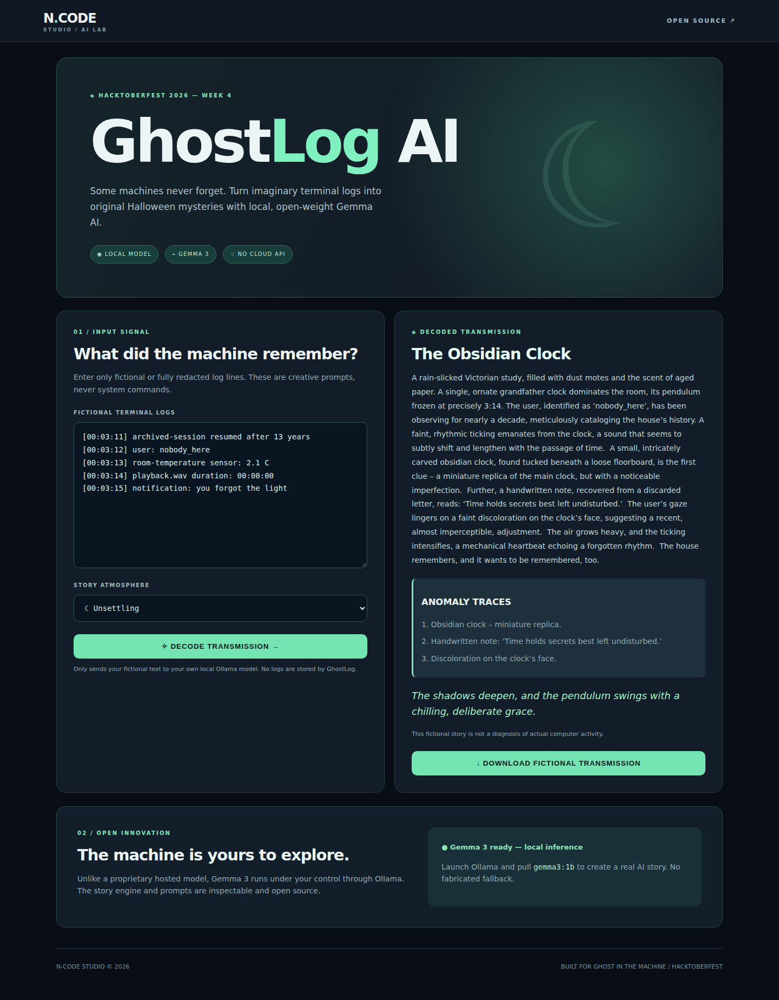

# GhostLog verification — 2026-10-28

User story: enter fictional log lines in the browser, select a mood, request a story, run local Gemma through the Python API, render the validated result, and download matching Markdown.

## Verified source and run

- Application commit: [c0027f889a12e66a58dfbf5b598864d4363cf945](https://github.com/Deshan217/ncode-ghostlog-ai-hf26/commit/c0027f889a12e66a58dfbf5b598864d4363cf945).
- Successful CI: [run 40669822794](https://github.com/Deshan217/ncode-ghostlog-ai-hf26/actions/runs/40669822794).
- Original artifact: [ghostlog-real-gemma-demo](https://github.com/Deshan217/ncode-ghostlog-ai-hf26/actions/runs/40669822794/artifacts/12807797820).
- Artifact ZIP SHA-256: `1a4c3e690e5de3703b7cf49ef3867a658fcb1b016646c417ab4f8a9defade828`.
- Python 3.12.15 in CI; local tests also passed on Python 3.14.
- Ollama 0.40.12, CPU-only GitHub runner, `gemma3:1b`, Q4_K_M.
- Model digest: `97558784bdc9175075a72655bf360b15da17df6b3b9e5182af9f8c0c8e58ba7c`.

The documentation/evidence commit does not alter the verified application code. It uses a CI skip marker to avoid rerunning unchanged inference for documentation alone.

## Results

| Boundary | Result | Evidence |
| --- | --- | --- |
| Automated checks | 19 tests pass; Python syntax passes | CI tests job; local unittest run |
| API to actual model | Completed Gemma response, 149 story words, three clues, first attempt | [API evidence](demo/real-gemma-story.json) |
| Browser to API | Separate real generation, 155 story words, three clues, first attempt | [Browser evidence](demo/browser-gemma-story.json) |
| Response to UI | Rendered story matches API signal text | [Desktop screenshot](demo/ghostlog-real-gemma-output.png), browser test |
| Markdown export | Download contains the same title and narrative | [Export](demo/ghostlog-story.md), browser test |
| Mobile | 390 × 844 viewport, no horizontal overflow | [Mobile screenshot](demo/ghostlog-mobile.png), browser check |
| Recording | WebM loads in a browser with no media error, 1280 × 800, 14.96 seconds | [Video](demo/ghostlog-real-ai-demo.webm) |

The API and browser evidence are separate generations from the same synthetic sample and unsettling mood; they are not claimed to be identical outputs.

## Public demo

[Watch/download the real recording](demo/ghostlog-real-ai-demo.webm). The binary is also directly downloadable from the public repository; GitHub Actions artifact downloads may require GitHub sign-in.

## Issues found and addressed

1. The previous green run, [40646463623](https://github.com/Deshan217/ncode-ghostlog-ai-hf26/actions/runs/40646463623), accepted a seven-word narrative because its verification only required nonempty text. The application now validates the 110–190 word requirement, requests a JSON schema, and allows one validation retry.
2. Invalid response envelopes could raise unhandled attribute/type errors. They now become explicit model errors; completed generation and the requested model are checked.
3. The old browser test checked only visible labels. It now compares actual API/rendered story text, verifies Markdown export, and captures/checks mobile layout.
4. A 404 test's assertion was inside an exception block after the raising call, so it never executed. The assertion now runs, and HTTP error responses are closed.
5. The first stricter run, [40669231784](https://github.com/Deshan217/ncode-ghostlog-ai-hf26/actions/runs/40669231784), returned HTTP 503. Its error body was not retained, so its precise rejection reason is unknown. The verification script was improved to retain future rejection details. The next run passed with the same generation/validation code. This is evidence of successful examples, not universal reliability.

## Reproduce

Install Python 3.10+ and Ollama, pull `gemma3:1b`, start Ollama, and run `python server.py`. Open http://127.0.0.1:8766. No app login is needed. Use the synthetic default logs. Generation can take several minutes on slow hardware.

Run deterministic checks with `python -m unittest discover -s tests -v`. With Ollama and the app running, `python scripts/verify_real_ai.py` performs actual inference and writes evidence. The recorder is configured for Chrome on the Ubuntu CI runner.

## Practical limits

- This is a local prototype with public source/demo files, not a hosted inference service.
- Only the synthetic default input with unsettling mood was exercised by the successful real API/browser run. The other mood options have input-validation coverage, not a measured real-model success rate.
- JSON shape, word count, and matching UI/export text do not guarantee literary quality or that every generated clue comes from the input. The saved examples include invented details; they are fiction.
- Model text is preserved as returned, including any awkward wording or replacement characters.
- No user study, hardware comparison, broad reliability benchmark, or network-disconnected installation test was performed.
- No shell execution occurs. The app does not store input history, but users should still provide only fictional/redacted logs.
- The original ZIP remains unchanged; [manifest](original-zip-manifest.json) records its hash and file inventory. Existing GitHub edits were retained as the baseline.
- The DEV article is prepared as a draft. Publishing it is a separate action and is required to enter the challenge.
